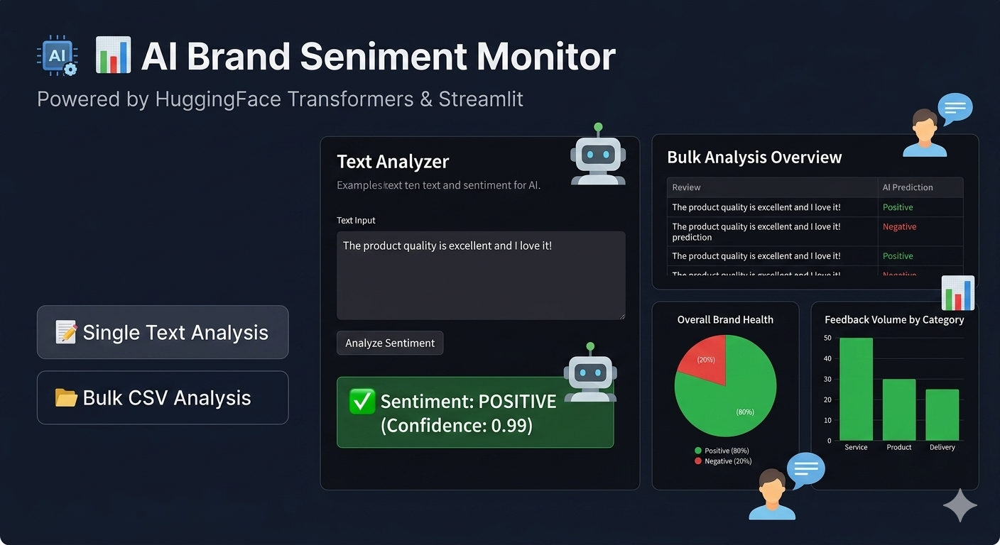

# 📊 AI Brand Sentiment Monitor

An interactive web application built with **Streamlit** that uses Natural Language Processing (NLP) to analyze the sentiment of customer feedback. The app leverages the **Hugging Face Transformers** library to classify text as either Positive or Negative.

---

### 🌟 Project Preview (Conceptual Dashboard)


*Note: This is a conceptual mockup of the dashboard. The actual app interface will vary.*

---

## 🚀 Features

* **Single Text Analysis:** Paste a single review to get an instant sentiment prediction with a confidence score.
* **Bulk CSV Analysis:** Upload a CSV file containing multiple reviews to process data in bulk.
* **Data Visualization:** Automatically generates Pie charts and Bar charts using **Plotly** to visualize overall customer satisfaction.
* **AI-Powered:** Uses the `distilbert-base-uncased-finetuned-sst-2-english` model for fast and accurate sentiment detection.

## 🛠️ Built With

* [Streamlit](https://streamlit.io/) - The web framework for Machine Learning.
* [Hugging Face Transformers](https://huggingface.co/docs/transformers/index) - State-of-the-art NLP models.
* [Pandas](https://pandas.pydata.org/) - For data manipulation.
* [Plotly Express](https://plotly.com/python/plotly-express/) - For interactive visualizations.

## 📦 Installation & Setup

1.  **Clone the repository:**
    ```bash
    git clone [https://github.com/Marampavan-319/Sentimental_AI.git](https://github.com/Marampavan-319/Sentimental_AI.git)
    cd Sentimental_AI
    ```

2.  **Install dependencies:**
    *(For your convenience, a `requirements.txt` file is included)*
    ```bash
    pip install -r requirements.txt
    ```

3.  **Run the application:**
    ```bash
    streamlit run app.py
    ```

## 📂 Data Format

For bulk analysis, ensure your CSV file has a column named **"Review"**. You can use the provided `demo_data.csv` as a template.

---
Created by [Marampavan-319](https://github.com/Marampavan-319).